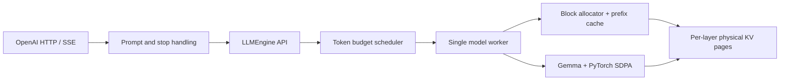

# MiniVLLM: a compact Gemma inference engine

A single-device PyTorch engine implementing request scheduling, paged KV storage,
prefix sharing and an OpenAI-compatible chat API. Gemma 3 270M tensor execution,
scheduling and memory management are implemented here, rather than delegated to
an inference library. Developed and measured on an **RTX 4070 Laptop, 8 GB, SM89**.

## Implemented

- Continuous **ragged decode batching**, fair across sampling cohorts.
- A token budget shared by decode and chunked prefill, with progress for both phases.
- KV-aware admission reserving maximum request growth; bounded outstanding requests.
- Physical KV pages, logical block tables, whole-page prefix sharing, reference
  counting, LRU eviction under memory pressure, cancellation and cleanup.
- Vectorized KV writes/gathers and RoPE; PyTorch SDPA with grouped-query attention.
- Last-position output projection; intermediate chunks skip the output head.
- One model worker, async JSON/SSE, bounded stream buffers, disconnect handling,
  split stop-string buffering, and shutdown that joins in-flight work.
- TTFT/TPOT, scheduler/KV metrics, saved GPU measurements, independent reference tests.

**Paged storage is implemented; fused paged attention is not.** Attention gathers
dense KV before SDPA. Explicit CUDA graphs, batched ragged prefill, preemption,
speculative decoding, quantization and multi-GPU execution are outside this version.

## Run

Python 3.10+ and PyTorch 2.5+. Install the appropriate PyTorch build for your GPU,
then:

```bash
python -m pip install -e ".[dev,benchmark,reference]"
python main.py --prompt "Explain KV caching in one sentence." --max-new-tokens 32
python -m adapters.openai.run
python query_fastapi.py --stream --prompt "Explain continuous batching."
```

CLI and server default to `google/gemma-3-270m-it`. Accept its Hugging Face license
and authenticate, or put `model.safetensors` and `tokenizer.json` in
`gemma-3-270m-it/`. CLI `--no-instruct` uses the base checkpoint in
`gemma-3-270m/`. Only 270M is supported. Use the default instruct configuration for
chat serving; the chat API advertises the instruct model.

CUDA uses BF16; CPU uses FP32. Compilation is **opt in** via
`GEMMA_ENABLE_COMPILE=1`; it is experimental and unbenchmarked. The tested Windows
path uses eager PyTorch and requires neither Triton nor a CUDA compiler.

## Architecture and lifecycle



1. The adapter validates; the app formats the Gemma prompt.
2. The engine tokenizes, creates a future and enqueues the request.
3. FIFO admission reserves pages for prompt and maximum generation. Cached whole
   pages may be shared; cache references can be evicted to make room.
4. Each tick runs a decode cohort, then prefills using the remaining token budget.
   If decode consumes the budget, the next turn serves prefill.
5. The worker builds metadata, writes KV, runs attention and samples. Decode IDs
   are copied to CPU once per batch. Prefill remains one request per forward.
6. JSON resolves the future; SSE consumes a bounded event queue. Completion,
   cancellation, timeout and errors release request references. Cache references
   retain reusable pages until eviction or shutdown.

The synchronous executor contains no asyncio. Model/KV mutation never overlaps;
HTTP handlers can run during model steps. See [architecture](docs/architecture.md),
the [pre-change audit](docs/audit.md), and the [study guide](docs/study.md).

## Measurements

Actual local measurements: Gemma 270M **base**, BF16, PyTorch 2.7.1+cu128, Windows
WDDM, RTX 4070 Laptop, greedy decoding, four short prompts, 16-token output cap,
three closed-loop waves per concurrency. Prefix caching and compilation disabled.

| Concurrency | Baseline tokens/s | Improved tokens/s |
|---:|---:|---:|
| 1 | 28.47 | 26.01 |
| 2 | 46.59 | 47.53 |
| 4 | 73.29 | 80.91 |
| 8 | 76.93 | 91.47 |


Higher concurrency benefits from ragged batching and fewer layer-level CPU/GPU
synchronizations. Single-request throughput did not improve in this run. These
small samples are not capacity/SLO guarantees. Read the
[methodology and raw results](benchmarks/README.md) before interpreting the figures.

```bash
python scripts/benchmark_engine.py --output benchmarks/my_engine.json
python scripts/benchmark_attention.py --output benchmarks/my_attention.json
python scripts/plot_benchmarks.py
```

There is **no measured vLLM comparison**. A shared HTTP workload runner and
comparison instructions are provided in [benchmarks/README.md](benchmarks/README.md).
No relative vLLM performance is claimed.

## Validate

```bash
python -m pytest -q
python -m ruff check inference gemma3 app adapters scripts
python scripts/validate_reference.py --model-dir gemma-3-270m
```

Tests include fake-runtime contracts, independent dense attention on CPU/CUDA,
and optional Transformers tiny-model reference logits without downloads. With
local base weights:

```powershell
$env:RUN_LOCAL_MODEL_TESTS="1"
python -m pytest -q
```

FP32 reference validation matched 24/24 tested greedy positions, maximum absolute
logit error about 2e-5. **BF16 is not exactly reference invariant:** recorded eager
and SDPA comparisons match 23/24 positions. Strict BF16 validation returns nonzero
for that mismatch; raw results are retained. Real-model tests separately verify
this engine's serial/batched, streamed, chunked and cached paths. These checks do
not establish equivalence for every input or precision.

## Configuration, observability and tradeoffs

Existing CLI flags and `GEMMA_API_*` variables remain supported. Main controls:
`MAX_BATCH_TOKENS`, `PREFILL_CHUNK_SIZE`, `DECODE_BATCH_SIZE`,
`MAX_CONCURRENT_REQUESTS`, `MAX_QUEUE_SIZE`, `MAX_KV_CACHE_TOKENS`, `KV_BLOCK_SIZE`,
`NUM_KV_BLOCKS`, `REQUEST_TIMEOUT_S`, `ENABLE_PREFIX_CACHE`.
`max_queue_size` bounds **all outstanding requests**, including active ones.
`prefill_chunk_size=None` now uses the token budget as the chunk bound.

Available endpoints: `/healthz`, `/readyz`, `/v1/models`, `/stats`, `/metrics`,
`/v1/chat/completions`. KV counters distinguish physical reserved pages from live
positions. Generation results expose `ttft_s` and `tpot_s`; benchmarks save raw
per-request observations.

Reservation reduces admission density and causes FIFO head-of-line blocking, but
guarantees progress without preemption. Small chunks bound decode interference
but add launches. Dense gather remains O(context) traffic even on sliding layers.
Prefix lookup scans bounded exact entries rather than a radix tree; scope is fixed
to `default` (trusted single tenant). Tokenization is synchronous; streaming
detokenizes accumulated IDs for Unicode correctness. Non-streaming stop strings
trim completed output rather than stopping computation early. HTTP body limits
currently rely on Content-Length plus schema limits.

Architectural references:
[vLLM scheduling](https://docs.vllm.ai/en/stable/configuration/optimization/),
[vLLM prefix caching](https://docs.vllm.ai/en/stable/design/prefix_caching/),
[SGLang scheduling](https://github.com/sgl-project/sglang/blob/main/python/sglang/srt/managers/schedule_policy.py).
