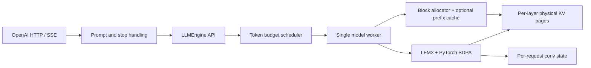
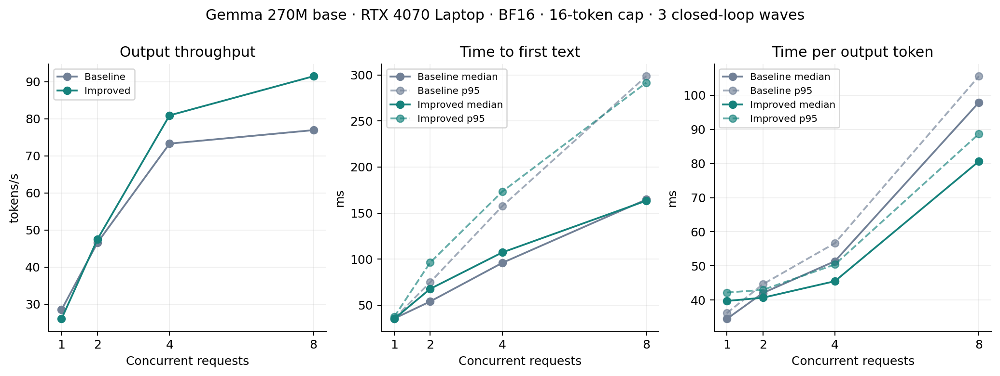

# MiniVLLM: a compact LFM3 inference engine

A single-device PyTorch engine implementing request scheduling, paged KV storage,
prefix-aware storage primitives and an OpenAI-compatible chat API. LFM3-1.7B
tensor execution, scheduling and memory management are implemented here rather
than delegated to an inference library. Developed and measured on an **RTX 4070
Laptop, 8 GB, SM89**.

## Implemented

- Continuous **ragged decode batching**, fair across sampling cohorts.
- A token budget shared by decode and chunked prefill, with progress for both phases.
- KV-aware admission reserving maximum request growth; bounded outstanding requests.
- Physical KV pages, logical block tables, reference counting, LRU eviction under
  memory pressure, cancellation and cleanup.
- Vectorized KV writes/gathers and RoPE; PyTorch SDPA with grouped-query attention.
- Packed Q/K/V and FFN gate/up projections, plus opt-in Triton paged decode attention.
- LFM3 short-convolution layers with per-request conv state, mixed with full and
  sliding-window attention layers.
- Last-position output projection; intermediate chunks skip the output head.
- Weight-only **int8** quantization (native CUDA weight-only kernel when available)
  and experimental **int4 NF4** via bitsandbytes.
- One model worker, async JSON/SSE, bounded stream buffers, disconnect handling,
  split stop-string buffering, and shutdown that joins in-flight work.
- TTFT/TPOT, scheduler/KV metrics, saved GPU measurements, independent reference tests.

**Fused paged attention is experimental and opt-in.** Set
`LFM3_FUSED_PAGED_ATTENTION=1` for direct-page CUDA decode with Triton. Prefill,
CPU, and unsupported decode shapes use dense-gather PyTorch SDPA. Batched ragged
prefill, preemption,
speculative decoding and multi-GPU execution are outside this version.

**Prefix caching is disabled for LFM3.** LFM3's short-convolution layers keep
recurrent state outside the paged KV cache. Reusing KV pages without a matching
conv-state snapshot would silently corrupt results, so the executor raises an
error if prefix caching is enabled for this model. The storage/prefix-cache
primitives remain in the engine and are covered by fake-runtime tests.

## Run

Python 3.10+ and PyTorch 2.5+. Install the appropriate PyTorch build for your GPU,
then:

```bash
python -m pip install -e ".[dev,benchmark,reference,quant]"
python main.py --prompt "Explain KV caching in one sentence." --max-new-tokens 32
python main.py --prompt "Explain KV caching in one sentence." --quantization int8
python -m adapters.openai.run
python -m adapters.openai.run --compile-model  # experimental; long first-request warmup
python query_fastapi.py --stream --prompt "Explain continuous batching."
```

CLI and server default to `LiquidAI/LFM3-1.7B`. Accept its Hugging Face terms and
authenticate, or put `model.safetensors` and `tokenizer.json` in `LFM3-1.7B/`.
Only the 1.7B LFM3 checkpoint is supported. The checkpoint is post-trained for
chat; `--no-instruct` sends the prompt verbatim instead of applying the LFM3 chat
template.

CUDA uses BF16; CPU uses FP32. Compilation is **opt in** via the server's
`--compile-model` flag or `LFM3_API_COMPILE_MODEL=true`; it is experimental and
needs a long warmup. The measured steady-state gain and caveats are in
[benchmarks](benchmarks/README.md). The tested Windows path uses eager PyTorch and
requires neither Triton nor a CUDA compiler.

On Linux/CUDA with Triton installed, try the optional paged decode kernel:

```bash
LFM3_FUSED_PAGED_ATTENTION=1 python -m adapters.openai.run --compile-model
```

Projection packing is always enabled and loads the original Hugging Face weights
without conversion files. It combines independent linear maps, not nonlinear
layers. Different GEMM shapes and attention reduction orders may change BF16
near-tied token choices; the tests check logits/tolerances, not universal token
identity. Keep the attention flag off to use the portable SDPA path.
Long contexts in the paged path automatically use split-KV parallelism with an
FP32 softmax merge; short contexts and ordinary sliding windows stay single-pass.

### Quantization

`--quantization` (or `LFM3_API_QUANTIZATION`) accepts:

| Mode | Weights | CUDA path | Notes |
|---|---|---|---|
| `none` | BF16 | BF16 linear | Reference quality |
| `int8` | Symmetric int8, per output channel | `torch._weight_int8pack_mm` | Recommended memory/quality tradeoff |
| `int4` | NF4 via bitsandbytes, double quantized | bitsandbytes 4-bit | Experimental; quality caveat |

Embeddings and the tied output head remain BF16: the output head shares storage
with the embedding, so quantizing it separately would break the tie and use more
memory. On CPU, int8 falls back to dequantizing each weight before the matmul.

Measured model allocation after loading the real checkpoint on the 8 GB laptop
GPU:

| Mode | Allocated | Greedy output on a short arithmetic prompt |
|---|---:|---|
| BF16 | 3.22 GiB | `2+2 equals 4.` |
| int8 | 1.87 GiB | identical token IDs |
| int4 | 1.22 GiB | experimental; failed to stop cleanly |

int4 saves another ~0.65 GiB but changed the model's stop behavior in testing.
Treat it as an experiment, not the default serving choice.

## Architecture and lifecycle



1. The adapter validates; the app formats the LFM3 chat prompt.
2. The engine tokenizes, creates a future and enqueues the request.
3. FIFO admission reserves pages for prompt and maximum generation, accounting
   for reusable pages when the generic prefix cache is enabled.
4. Each tick runs a decode cohort, then prefills using the remaining token budget.
   If decode consumes the budget, the next turn serves prefill.
5. The worker builds metadata, writes KV and conv state, runs attention and
   samples. Decode IDs are copied to CPU once per batch. Prefill remains one
   request per forward.
6. JSON resolves the future; SSE consumes a bounded event queue. Completion,
   cancellation, timeout and errors release request references.

The synchronous executor contains no asyncio. Model/KV mutation never overlaps;
HTTP handlers can run during model steps. See [architecture](docs/architecture.md),
the [pre-change audit](docs/audit.md), and the [study guide](docs/study.md).

## Measurements

### LFM3 model memory

LFM3-1.7B BF16 generation peaks at about **3.32 GiB** allocated for model,
KV cache and live temporaries on the 8 GB laptop GPU. int8 reduces the resident
model allocation from 3.22 GiB to 1.87 GiB; int4 to 1.22 GiB. These are
`torch.cuda.memory_allocated`/`max_memory_allocated` values, not total VRAM or
allocator reservation.

On short prompts with 32 output tokens, eager BF16 measured **677 tokens/s** at
128 concurrent requests / decode batch 128. With `torch.compile` and CUDA-graph
replay, after a full compile warmup wave, it measured **1,058 tokens/s** for the
same workload, about 56% faster. Compilation warmup took about 155 seconds. Cache
buffers now have stable addresses and decode batches/context lengths are bucketed
for graph replay; some distinct shapes are still captured during warmup. Treat
this as an experimental steady-state result, not an end-to-end service guarantee.

A subsequent same-workload check measured **1,075 tokens/s** before projection
packing, **1,112** with packed projections, and **1,173** with packed projections
plus fused paged decode. These short laptop-GPU runs are indicative, not a
power-controlled study; see [benchmark details](benchmarks/README.md).

### Recorded optimization results

All LFM3 throughput results below used **our custom engine** on the RTX 4070
Laptop 8 GB under WSL2. They are not HTTP-serving benchmarks. Warmup/model loading
are excluded unless stated otherwise; clocks and power were not locked. Separate
runs vary, so compare paired experiments rather than treating this as a cumulative
speedup ladder.

| Short-prompt experiment | Before (output tokens/s) | After | Notes |
|---|---:|---:|---|
| Initial eager vs. compiled BF16 | 591 | 995 | Batch/concurrency 128; two measured waves |
| Repeated eager vs. compiled BF16 | 677 | 1,082 | Batch/concurrency 128; three waves |
| Stable-address caches + graph padding | 1,082 compiled | 1,058 | No demonstrated extra throughput gain; separate runs |
| Q/K/V + FFN gate/up packing | 1,075 | 1,112 | Paired three-wave experiment |
| Packed projections + paged decode | 1,112 | **1,173** | Same workload; about 9.2% over 1,075 |

Short prompts used a 32-token output cap. Compiled warmup took roughly 111–160
seconds in these experiments. Keeping prefill eager while compiling decode was
also tried (~757 tokens/s); it was slower and was not retained. BF16 reduction
order can change near-tied token choices, so these optimizations do not guarantee
token-identical outputs. Raw projection/attention comparison:
[`benchmarks/lfm3_fusion.json`](benchmarks/lfm3_fusion.json).

### Long-prompt split-KV: actual engine tokens/s

Compiled BF16, packed projections, fused paged attention, concurrency 1, 64 output
tokens, two warmup waves and three measured waves. Each mode/context was measured
in a fresh process with the same synthetic repeated-text chat.

| Prompt tokens | Single-pass total tok/s | Split-KV total tok/s | Gain | Single-pass decode tok/s | Split-KV decode tok/s |
|---:|---:|---:|---:|---:|---:|
| 2,048 | 44.34 | 45.18 | **+1.9%** | 54.49 | 55.87 |
| 8,192 | 27.89 | 28.73 | **+3.0%** | 51.26 | 54.79 |

Total throughput includes prefill and scheduling; decode-worker throughput does
not. At 8K, decode improved **6.9%**. Generated token hashes matched at 8K but
differed at 2K. These are small-sample results, not a quality evaluation. Short
contexts do not activate split-KV. Raw runs are saved in
[`benchmarks/`](benchmarks/) as `lfm3_split_kv_engine_{2048,8192}_{single,auto}.json`.

### Attention-only measurements (not model throughput)

Synthetic BF16, 16 query heads / 4 KV heads, head dimension 128, 16-token pages.
The first comparison used batch 16, five warmups and 30 timed iterations:

| Context | Attention window | Dense gather + eager SDPA ms | Paged decode ms |
|---:|---|---:|---:|
| 128 | Full | 0.268 | 0.023 |
| 512 | Full | 0.491 | 0.063 |
| 2,048 | Full | 1.754 | 0.382 |
| 2,048 | 256 | 1.835 | 0.032 |

Split-KV compared against the previous direct-page kernel with 100 CUDA graph
replays per configuration:

| Batch | Full context | Single-pass ms | Split-KV ms | Auto partitions |
|---:|---:|---:|---:|---:|
| 1 | 2,048 | 0.064 | 0.023 | 4 |
| 1 | 8,192 | 0.251 | 0.049 | 16 |
| 16 | 2,048 | 0.345 | 0.296 | 2 |
| 16 | 8,192 | 1.536 | 1.188 | 8 |

These exclude projections and KV writes; **do not extrapolate kernel speedups to
whole-model tokens/s**. Raw split-KV summary:
[`benchmarks/lfm3_split_kv.json`](benchmarks/lfm3_split_kv.json).

### Earlier batching and quantization sweeps

Before projection packing/paged decode, the eager BF16 concurrency sweeps recorded
the following short-prompt results (32-token output cap, two measured waves):

| Concurrent requests | Decode batch cap | Aggregate output tokens/s |
|---:|---:|---:|
| 1 | 32 | 25.72 |
| 2 | 32 | 51.35 |
| 4 | 32 | 99.15 |
| 8 | 32 | 184.51 |
| 16 | 32 | 290.79 |
| 24 | 32 | 330.25 |
| 32 | 64 | 448.53 |
| 48 | 64 | 517.61 |
| 64 | 64 | 569.66 |
| 96 | 128 | 603.18 |
| 128 | 128 | 620.53 |
| 192 | 256 | 587.14 |
| 256 | 256 | 605.39 |

These span different runs and batch caps, not a single controlled scaling curve.
The corresponding int8 sweep recorded 18.20 tokens/s at concurrency 1, 40.89 at
4, 47.26 at 8, 50.20 at 16 and 51.99 at 32. Int8 saved memory but was much slower
than BF16 in this implementation; no int4 throughput claim is made.

Latest full WSL test run: **157 passed, 7 skipped**. Local real-checkpoint
serial/batched/streaming/chunked tests also passed with fused paged decode enabled.

The historical engine sweep below was collected on Gemma 270M **before** the
LFM3 migration. It is retained as a record of the scheduling/attention changes,
not as a current LFM3 performance claim:

| Concurrency | Baseline tokens/s | Improved tokens/s |
|---:|---:|---:|
| 1 | 28.47 | 26.01 |
| 2 | 46.59 | 47.53 |
| 4 | 73.29 | 80.91 |
| 8 | 76.93 | 91.47 |



Higher concurrency benefited from ragged batching and fewer layer-level CPU/GPU
synchronizations. Single-request throughput did not improve in that run. These
small samples are not capacity/SLO guarantees. Read the
[methodology and raw results](benchmarks/README.md) before interpreting the
figures. The LFM3 engine measurements above do not establish HTTP-serving capacity.

```bash
python scripts/benchmark_engine.py --output benchmarks/my_engine.json
python scripts/benchmark_engine.py --quantization int8 --output benchmarks/my_engine_int8.json
python scripts/benchmark_tps.py --concurrency 128 --decode-batch-size 128 --compile
python scripts/benchmark_tps.py --concurrency 128 --decode-batch-size 128 --compile --fused-paged-attention
python scripts/benchmark_paged_attention.py
python scripts/profile_decode.py --batch-size 128 --steps 16
python scripts/benchmark_attention.py --output benchmarks/my_attention.json
python scripts/plot_benchmarks.py
```

There is **no measured vLLM comparison**. A shared HTTP workload runner and
comparison instructions are provided in [benchmarks/README.md](benchmarks/README.md).
No relative vLLM performance is claimed.

## Validate

```bash
python -m pytest -q
python -m ruff check inference lfm3 app adapters scripts
python scripts/validate_reference.py --model-dir LFM3-1.7B --dtype bfloat16
```

Tests include fake-runtime contracts, independent dense attention on CPU/CUDA,
quantization unit tests, and optional Transformers tiny-model reference logits
without downloads. With local LFM3 weights:

```powershell
$env:RUN_LOCAL_MODEL_TESTS="1"
python -m pytest -q
```

The tiny FP32 LFM3 reference test matches Transformers to about `1.27e-7` maximum
absolute logit error. On the real BF16 checkpoint, the chat prompt matched all 8
tested greedy tokens; one raw prompt position differs because both top candidates
are tied at the BF16 noise floor (native top-2 gap `0.0`, reference gap `0.125`).
The reference script records per-step logits and top-2 gaps and only exits
nonzero with `--strict`. Real-model tests separately verify this engine's
serial/batched, streamed, chunked and cached paths.

## Configuration, observability and tradeoffs

Settings use the `LFM3_API_*` prefix. Main controls:
`MODEL_ID`, `QUANTIZATION`, `COMPILE_MODEL`, `MAX_BATCH_TOKENS`,
`PREFILL_CHUNK_SIZE`, `DECODE_BATCH_SIZE`, `MAX_CONCURRENT_REQUESTS`,
`MAX_QUEUE_SIZE`, `MAX_KV_CACHE_TOKENS`, `KV_BLOCK_SIZE`, `NUM_KV_BLOCKS`,
`REQUEST_TIMEOUT_S`, `ENABLE_PREFIX_CACHE`. `max_queue_size` bounds **all outstanding requests**,
including active ones. `prefill_chunk_size=None` uses the token budget as the
chunk bound. `ENABLE_PREFIX_CACHE` must stay false for LFM3.

Available endpoints: `/healthz`, `/readyz`, `/v1/models`, `/stats`, `/metrics`,
`/v1/chat/completions`. KV counters distinguish physical reserved pages from live
positions. Generation results expose `ttft_s` and `tpot_s`; benchmarks save raw
per-request observations.

Reservation reduces admission density and causes FIFO head-of-line blocking, but
guarantees progress without preemption. Small chunks bound decode interference
but add launches. Dense gather remains O(context) traffic even on sliding layers.
Sliding layers still reserve full KV storage in this version. Tokenization is
synchronous; streaming detokenizes accumulated IDs for Unicode correctness.
Non-streaming stop strings trim completed output rather than stopping computation
early. HTTP body limits currently rely on Content-Length plus schema limits.

Architectural references:
[vLLM scheduling](https://docs.vllm.ai/en/stable/configuration/optimization/),
[vLLM prefix caching](https://docs.vllm.ai/en/stable/design/prefix_caching/),
[SGLang scheduling](https://github.com/sgl-project/sglang/blob/main/python/sglang/srt/managers/schedule_policy.py).
