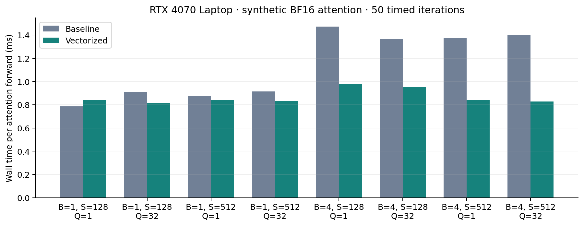

# Measurements and methodology

## Recorded environment and scope

RTX 4070 Laptop GPU (8,188 MiB reported), SM89, NVIDIA driver 595.79,
Windows 11 WDDM, Python 3.12.10, PyTorch 2.7.1+cu128, BF16, eager execution.
Base checkpoint: `google/gemma-3-270m`, local cached revision
`9b0cfec892e2bc2afd938c98eabe4e4a7b1e0ca1` (see checkpoint SHA256 in JSON).
No gated instruct checkpoint was downloaded. These base-model results do not
measure chat quality or HTTP overhead.

The baseline was recorded after KV/lifecycle fixes, before attention/scheduling
performance changes; prefix caching was off, so those ownership fixes do not
exercise the benchmark path. The original performance code comes from revision
`f0def66e6773229dcec3b6d4f081df3fe71b6a7e`. Improved data comes from the changed
working tree. BF16 norm arithmetic was corrected as part of the work, so exact
baseline token hashes are not a correctness oracle.

## Engine sweep

`benchmark_engine.py` loads one model, allocates 8,192 KV slots (16-token pages),
warms one 16-token request, then measures three waves at concurrency 1/2/4/8.
Decode batch cap is 4, token budget 256, maximum active requests 16. Greedy
sampling: temperature 0, top_p 1, top_k 0, repetition penalty 1. No prefix caching
or compilation. Prompt texts and raw request measurements are retained in JSON.
All recorded requests generated 16 tokens.

Output throughput is total actual sampled tokens / elapsed wall time. TTFT is
submit-to-first nonempty text event observed by the async consumer. TPOT is
first-to-last text arrival span / subsequent output token count. For these prompts
there is one text event per token; in general Unicode buffering or EOS can make
content event counts differ from token counts. The current runner takes total
token usage from the terminal event. Internal `ttft_s`/`tpot_s` timestamp sampling
rather than consumer delivery.

Peak memory is PyTorch `max_memory_allocated`, including model, RoPE, KV tensors
and live temporaries, not total VRAM usage or allocator reservation. Recorded
peaks were approximately 728.5-731.5 MiB; the benchmark KV pool is smaller than the
32,768-slot server default. `/stats` exposes live positions and reserved/retained
physical pages for workload inspection.

| Concurrency | Baseline output tok/s | Improved output tok/s | Change |
|---:|---:|---:|---:|
| 1 | 28.47 | 26.01 | -8.6% |
| 2 | 46.59 | 47.53 | +2.0% |
| 4 | 73.29 | 80.91 | +10.4% |
| 8 | 76.93 | 91.47 | +18.9% |

The single-request regression is retained. These are small samples with no locked
GPU clocks or isolated desktop workload. Repeated improved sweeps during development
varied, particularly at concurrency 4. Treat percentages as observations of the
saved runs, not stable guarantees or statistically established speedups. The worker
handoff trades some single-request overhead for event-loop responsiveness; the
batching and attention changes benefit higher concurrency. No result supports a
claim of parity or superiority to vLLM.


```bash
python scripts/benchmark_engine.py --output benchmarks/my_engine.json
python scripts/benchmark_attention.py --output benchmarks/my_attention.json
python scripts/plot_benchmarks.py
```

The plotting script reads the named baseline/improved files; custom result names
are preserved without overwriting the checked-in evidence.

## Attention microbenchmark

`attention_baseline.json` and `attention_vectorized.json` measure one synthetic
attention layer: embedding 640, 4 query heads, 1 KV head, head dim 256, BF16, page
size 16; batch 1/4, context 128/512, query length 1/32. Ten warmups and 50 timed
iterations per shape, with CUDA synchronization around the timed loop. Random
weights/KV, no RoPE or QK norm; this is not end-to-end model performance. Both
versions use the same script and seed. The standalone path may read one sequence
bound per forward; the engine passes its CPU-known bound instead.

Batch-4 latency fell from about 1.36-1.47 ms to 0.83-0.98 ms in this run.
Batch-1 results were mixed, including a slower 128-context decode shape. No custom
kernel was introduced. SDPA chooses its backend; a specific FlashAttention backend
is not asserted without a kernel trace.



## Numerical validation

`reference.json` compares local weights with Transformers 4.52.4 eager FP32
attention: three prompts, eight positions each, recomputing the full reference
context on every step. The native path uses its paged cache. All 24 tested greedy
positions match; maximum absolute logit error is about 2e-5. The continuation is
teacher-forced from reference tokens, so agreement is tested at identical contexts.
The tiny-model test also checks all logits across chunk boundaries and sliding
windows; independent dense attention tests cover ragged batches and multiple KV
heads on CPU and CUDA.

`reference_bfloat16.json` and `reference_bfloat16_sdpa.json` retain strict BF16
validation failures: 23/24 tested positions match, maximum absolute errors 0.5
(eager) / 0.375 (SDPA). At the SDPA mismatch, the native top two candidate logits
tie; the reference gap is 0.0625. Kernel/precision accumulation differences remain
a limitation, not an assertion of exact BF16 reference equivalence. The runner
returns nonzero on any greedy mismatch. Native serial/batched, streamed, chunked
and cached outputs passed separate real-model regression tests on the tested inputs.

```bash
python scripts/validate_reference.py --model-dir gemma-3-270m
python scripts/validate_reference.py --dtype bfloat16 --attention sdpa --output benchmarks/my_bf16.json
```

## Equivalent vLLM workload (not measured here)

Use a compatible Linux/CUDA host with vLLM installed. Use the same **instruct**
checkpoint and tokenizer revision on both servers. Run one server at a time on
the same GPU; record versions, clocks, power, model revision and memory settings.

```bash
vllm serve google/gemma-3-270m-it --served-model-name gemma-3-270m-it --dtype bfloat16 --max-model-len 2048 --max-num-seqs 16 --max-num-batched-tokens 256 --gpu-memory-utilization 0.7 --enforce-eager --no-enable-prefix-caching
python scripts/benchmark_serving.py --url http://127.0.0.1:8000 --label vllm --output benchmarks/vllm_http.json
```

Stop vLLM, start this engine with equivalent limits, then run the same client:

```bash
python -m adapters.openai.run --decode-batch-size 16 --max-concurrent-requests 16 --max-batch-tokens 256
python scripts/benchmark_serving.py --url http://127.0.0.1:8000 --label minivllm --output benchmarks/minivllm_http.json
```

The client sends identical prompts, sampling, token caps and closed-loop arrival
waves to `/v1/chat/completions`. It requires usage rather than counting text chunks
as tokens. Confirm prompt token counts/chat templates and actual output lengths
match before attributing differences to the engine; identical API inputs alone
cannot guarantee identical model formatting. Compare p50/p95 TTFT, TPOT, output
throughput, failures and GPU memory. Longer prompts and realistic arrivals require
additional workloads. The base engine benchmark above is not comparable to these
instruct HTTP runs. Explicit graph optimizations are disabled in the example to
isolate eager execution; benchmark production vLLM defaults separately.

Reference: [vLLM serve options](https://docs.vllm.ai/en/stable/cli/serve/).

## Remaining validation

The original instruct-only real/load suites remain opt-in and skipped without
local instruct assets. No full load/SLO study, long-context power-controlled sweep,
vLLM comparison or graph-replay benchmark has been recorded. Study figures label
illustrative page mapping and analytical memory separately from measurements.

## Windows virtual-environment verification

The final suite also runs with the existing Windows interpreter at
`E:/learning/DeepLearning/.venv/Scripts/python.exe` (Python 3.12.11,
PyTorch 2.11.0+cu128, CUDA). Test/API/reference dependencies absent from that
environment were reused from the available Windows installation and local
`.test-deps`; the shared venv was not modified. The JUnit report is
[`tests_windows_venv.xml`](tests_windows_venv.xml). Performance JSON above remains
explicitly tied to PyTorch 2.7.1; no 2.11 performance result is claimed.
