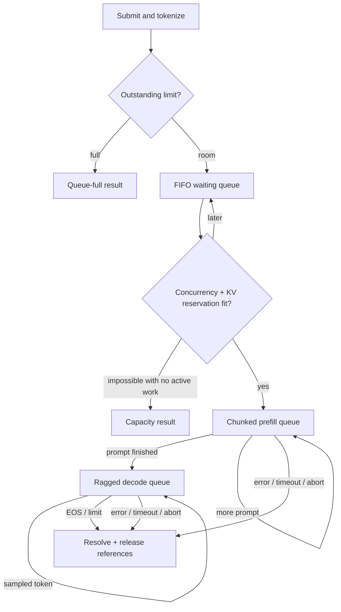

# Architecture

The public `LLMEngine` and `InferenceEngine` interfaces remain `generate`,
`stream`, `abort`, `stats`, and `shutdown`.

| Package | Responsibility | Boundary |
|---|---|---|
| `adapters/openai` | FastAPI, HTTP errors, SSE | No torch or model loading |
| `app` | Prompting, stop strings, usage, metrics | No HTTP dependency |
| `inference` | Scheduler, executor, allocation, sampling | No HTTP/runtime-loader dependency |
| `runtime` | Loading, tokenizer, device policy | No serving dependency |
| `lfm3` | Tensor operations, conv state, physical KV storage | No serving/runtime dependency |
| `config` | Existing CLI/env settings | Converted to engine config |

Tests enforce import boundaries. The admission module remains a compatibility
export; the scheduler directly checks the concurrency cap.

## Scheduling



Each tick expires/cancels all known requests and admits FIFO while capacity permits.
Decode selects the oldest request's sampling cohort, capped by batch size and
`max_batch_tokens`. Sequence lengths may differ; every decode input is one token.
The default round executes one step; optional settled-cohort greedy chunks
charge `eligible_requests * steps` against that same budget.
Remaining budget serves one chunk from each queued prefill, in round-robin order.
When decode exhausts the budget while prefill waits, the next tick reserves a
prefill turn. With `enable_prefill_batching`, the oldest chunk anchors a batch
of equal-length chunks with matching sampling settings and completion phase.
Each request receives at most one chunk per round, and the sum of all chunk
lengths must fit the remaining token budget. Prior KV lengths may differ; no
padding or mixed prefill/decode forward is needed. Models advertise support
through `supports_batched_prefill`.

Admission reserves
`ceil(min(context_limit, prompt_tokens + max_new_tokens - 1) / block_size)` pages,
accounting for prefix reuse. The final sampled token does not enter KV. Reservation
is physical and guarantees progress, at the cost of unused pages and FIFO
head-of-line blocking. No recomputation/preemption subsystem is required.

## KV ownership and layouts

```text
K and V per layer: [physical blocks, KV heads, block size, head dimension]
logical position p -> block_table[p // block_size], offset p % block_size
batch block tables: [B, max_reserved_blocks], padded with -1
KV lengths: [B], positions written before the current forward
```

Append indexes `[physical_block, :, offset, :]` directly. A head-major view of
block-major storage is invalid with multiple KV heads; regression tests cover it.
The CPU allocator has a free-list and physical page refcounts. Each request owns
one reference per attached page; each inserted cache entry owns another. Duplicate
inserts create no ownership. Eviction releases cache references; active requests
keep their references. A page returns to the free-list only at refcount zero.

Cache entries hold token tuples and whole-page block lists. Lookup chooses the
longest cached entry that is a prefix of the incoming prompt. LRU eviction occurs
on entry-count pressure and physical-page pressure. This bounded linear scan does
not implement arbitrary radix-prefix splitting.

LFM3's short-convolution layers keep recurrent state in a separate per-request
slot, not in paged KV. The executor therefore sets
`supports_prefix_cache = False` for LFM3 and rejects `enable_prefix_cache=True`.
The generic cache and its ownership tests remain available for runtimes whose
entire recurrent state lives in the KV pages.

Exact hits must recompute logits for at least the last token. Reuse is capped at
`floor(min(cached_tokens, prompt_tokens - 1) / block_size) * block_size`.
The final page is private. Up to one page is recomputed to avoid mutating shared
pages or adding copy-on-write machinery.

## Execution

The scheduler sends synchronous steps to one `ThreadPoolExecutor` worker, awaiting
each before any further allocator/model mutation. HTTP and request submission can
run during execution. Tokenization/admission still run on the event loop. Handoff
adds overhead; its purpose is responsiveness, not single-request speed.

The executor prepares or reuses a batch block-table tensor and length vector, passing a
CPU-known maximum sequence length through all layers. There are no per-layer
sequence-scalar reads in the engine path. RoPE indexes positions for all rows at
once. KV gather produces `[B, G, S, D]` with batch indexing; right-padding reads
page zero and is excluded by the mask. The allocator guarantees live page indices.

LFM3 has 24 transformer blocks: 13 short-convolution blocks, 6 full-attention
blocks and 5 sliding-attention blocks. Attention writes K/V to pages and also
applies Q/K RMSNorm, RoPE and a per-head sigmoid gate. The convolution blocks
consume and update a per-request state tensor of shape
`[emb_dim, kernel_size - 1]`; the executor allocates one slot per concurrent
request and carries it across prefill chunks and decode steps.

SDPA receives Q `[B,H,Q,D]`, K/V `[B,G,S,D]`, `enable_gqa=True`, and additive mask
`[B,1,Q,S]` combining causal, sliding and per-row lengths. Flash attention cannot
consume that mask, so the default priority selects the memory-efficient kernel.
`lfm3.attention.prefer_cudnn_attention` instead gives the fused cuDNN kernel
priority before the first forward when
`EngineConfig.enable_cudnn_attention` is opted into (off by default); the
dispatcher still falls back per shape, and cuDNN reductions can be
non-reproducible at some shapes. Compiled artifacts are kept in a
separate `minivllm-cudnn-attention` cache directory because Inductor's graph key
does not include the backend priority. Dense gather is still an O(context)
allocation/copy for full-attention layers. Sliding layers gather at most
`window + chunk_length - 1` keys per row, starting at each row's own window;
their masks retain absolute positions for causal and ragged-length checks.
In compiled single-token decode, short convolutions use an FP32 dot product
over the recurrent state and new input, allowing pointwise fusion. Eager and
multi-token execution retain the general depthwise convolution.
Inference mode is used, final-position logits are `[B,1,V]`, and
sampled decode IDs transfer to CPU once per batch or bounded greedy chunk. Intermediate prefill chunks
skip vocabulary projection.

CUDA BF16 and CPU FP32 are supported without Hopper-specific instructions. The
optional int8 path stores per-output-channel int8 weights and uses PyTorch's
weight-only int8 kernel on CUDA when available; otherwise it dequantizes before
the matmul. int4 uses bitsandbytes NF4 and is experimental.

Opt-in `torch.compile(mode="reduce-overhead")` owns CUDA graph capture/replay.
The executor marks persistent KV and convolution buffers as static-address inputs
and buckets decode batch/context sizes. RoPE buffers grow eagerly before compiled
execution so graph-pool outputs cannot become persistent cache storage. RoPE
canonicalizes the current CUDA device alias before comparing cache locations;
`cuda` and `cuda:0` must reuse the same buffers. Compiled preparation restores the
configured RoPE cache dtype once after model conversion, preserving the precision
of the previous compiled rebuild path. Ordinary eager execution retains its prior
buffer precision. The cache then changes only for growth or device migration.
The runtime wraps the compiled forward with a 32-entry specialization budget: prefill/decode
phase and shape variations otherwise exhausted the default eight entries and
triggered eager fallback. The configuration patch is restored after every call,
including failures. Compilation remains experimental; warmup and capture costs
are excluded from steady-state measurements. There is no manually managed CUDA
graph implementation.

Repetition penalties upload one batch of row/token indices instead of launching
copies and indexing operations per request. Tensor histories use gather/scatter
on the device; duplicate IDs receive the penalty once. Logits are copied only
when the penalty will mutate them. A completed prefill batch, like decode, copies
sampled IDs to the CPU once before updating per-request state.

### Overlap and stable decode metadata

The worker queues forward, sampling, and a non-blocking copy into a reusable
pinned host buffer. A CUDA event fences the buffer before the worker reads it.
Once device work is queued, a notification lets the event loop emit the previous
step's text while the worker waits. Only the event loop owns stream queues and
decoder state; only the worker advances model, KV, and convolution state.

Pending emission holds an immutable token-prefix length and token ID, with at
most one notification per active stream. The worker may append a newer suffix;
emission reads only the captured prefix. Slow-consumer errors are deferred until
the worker returns, so a callback never reclaims pages used by a live forward.
Final tokens and pending text flush before the terminal event. Pending text also
flushes before a long prefill rather than waiting behind it.

A single metadata cache entry covers the most recent compiled decode cohort.
Request order, complete page mappings, padded shape, convolution slots and the
expected next sequence lengths must match before reuse. Stable block tables and
slot IDs stay on the device; active lengths increment on the worker's stream,
while padded lengths remain zero. Any mismatch reconstructs the tensors. This
removes synchronous metadata uploads from consecutive stable steps.

The LFM3 tokenizer optionally supplies a native incremental decoder. Each stream
feeds only newly generated IDs, preserves UTF-8 tails, and tracks emitted
character count. Completion performs one full decode to flush an unfinished
tail. Generic tokenizers and older tokenizers releases retain full-prefix
decoding. This avoids repeated full-history decoding during long outputs.

### Optional exact greedy chunks

`decode_steps_per_round` defaults to one. With compilation, greedy sampling and
repetition penalty 1, a larger value chains ordinary autoregressive GPU outputs
before one sampled-ID transfer and host commit. Every next input is the actual
preceding argmax; there is no draft model or token prediction shortcut. Host
history updates commit each row in bulk without intermediate GPU tensor views.

Chunks run only for a settled single cohort. Waiting requests, pending prefill or
another decode cohort retain one-step scheduling. The chunk is capped by the
shared token budget, every request's remaining output reservation, and the model
context limit. Private EOS rows may execute unused positions until the chunk
ends; output and history stop at the first EOS, and pages release after the
device event completes. Other sampling configurations use one step.

Larger chunks trade more throughput for burstier text events and later
cancellation checks. First-to-last token timing averages do not describe that
cadence. See the [overlap measurements](../benchmarks/overlap_optimization/README.md)
for tested settings, power telemetry and reproduction commands.

## Lifecycle and serving

Internal futures are shielded from caller cancellation. Abort/timeout runs between
scheduling rounds; a configured greedy chunk can contain several steps, and
launched kernels finish. Initialization/execution errors resolve requests
and release pages. All known requests, including buried waiting requests, are
checked for expiry each tick.

Streams buffer 64 events, reserving a terminal slot. Slow consumers fail and release
pages instead of stalling other requests. Explicit iterator closing propagates
through adapter/app/engine. Non-streaming HTTP polls for disconnect while awaiting
completion. Shutdown stops admission, marks requests cancelled, joins the scheduler
and worker, then clears cache references.

Incremental or accumulated token decoding handles Unicode tails. Stop-string prefix
suffixes are held until safe to emit. EOS is omitted from text but included in usage.

## Metrics and limits

`EngineStats` includes queued/active counts, scheduled token count, live KV positions,
physical page capacity/use, phase batch sizes and cache counters. Reserved pages
include future growth and cached pages; live positions are different. These are
snapshots, not atomic GPU utilization measurements.

`ttft_s` measures submit-to-first-sampled-token time. `tpot_s` measures elapsed
first-to-last token time divided by subsequent token count, including scheduler
waits. Legacy prefill/decode host timing spans are not exact CUDA kernel timings.
Use client-observed throughput/latency and synchronized microbenchmarks for claims.

The throughput runner's optional `--phase-timing` records CUDA events around worker
phases, without synchronizing each intermediate chunk. Prefill rates count input
tokens; decode rates count generated tokens after the first token, which is sampled
during prefill. Phase time includes sampling, transfers and launch gaps inside that
worker call; queueing and the other phase are excluded. End-to-end generation rates
include both phases and scheduling. See the dated [status](status.md) for the
validated configuration and remaining work.

Limits: one model/device/tenant, synchronous tokenization, Python bookkeeping,
dense gather for full attention, full KV storage even for sliding layers, no prefix cache for LFM3,
no preemption, and recorded BF16 reference differences. See
[performance and validation](../benchmarks/README.md).
