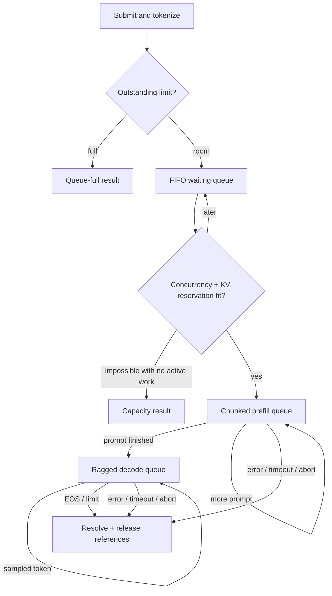

# Architecture

The public `LLMEngine` and `InferenceEngine` interfaces remain `generate`,
`stream`, `abort`, `stats`, and `shutdown`.

| Package | Responsibility | Boundary |
|---|---|---|
| `adapters/openai` | FastAPI, HTTP errors, SSE | No torch or model loading |
| `app` | Prompting, stop strings, usage, metrics | No HTTP dependency |
| `inference` | Scheduler, executor, allocation, sampling | No HTTP/runtime-loader dependency |
| `runtime` | Loading, tokenizer, device policy | No serving dependency |
| `gemma3` | Tensor operations and physical KV storage | No serving/runtime dependency |
| `config` | Existing CLI/env settings | Converted to engine config |

Tests enforce import boundaries. The admission module remains a compatibility
export; the scheduler directly checks the concurrency cap.

## Scheduling



Each tick expires/cancels all known requests and admits FIFO while capacity permits.
Decode selects the oldest request's sampling cohort, capped by batch size and
`max_batch_tokens`. Sequence lengths may differ; every decode input is one token.
Remaining budget serves one chunk from each queued prefill, in round-robin order.
When decode exhausts the budget while prefill waits, the next tick reserves a
prefill turn. Forwards are separate: no mixed or batched ragged prefill kernel.

Admission reserves
`ceil(min(context_limit, prompt_tokens + max_new_tokens - 1) / block_size)` pages,
accounting for prefix reuse. The final sampled token does not enter KV. Reservation
is physical and guarantees progress, at the cost of unused pages and FIFO
head-of-line blocking. No recomputation/preemption subsystem is required.

## KV ownership and layouts

```text
K and V per layer: [physical blocks, KV heads, block size, head dimension]
logical position p -> block_table[p // block_size], offset p % block_size
batch block tables: [B, max_reserved_blocks], padded with -1
KV lengths: [B], positions written before the current forward
```

Append indexes `[physical_block, :, offset, :]` directly. A head-major view of
block-major storage is invalid with multiple KV heads; regression tests cover it.
The CPU allocator has a free-list and physical page refcounts. Each request owns
one reference per attached page; each inserted cache entry owns another. Duplicate
inserts create no ownership. Eviction releases cache references; active requests
keep their references. A page returns to the free-list only at refcount zero.

Cache entries hold token tuples and whole-page block lists. Lookup chooses the
longest cached entry that is a prefix of the incoming prompt. LRU eviction occurs
on entry-count pressure and physical-page pressure. This bounded linear scan does
not implement arbitrary radix-prefix splitting.

Exact hits must recompute logits for at least the last token. Reuse is capped at
`floor(min(cached_tokens, prompt_tokens - 1) / block_size) * block_size`.
The final page is private. Up to one page is recomputed to avoid mutating shared
pages or adding copy-on-write machinery.

## Execution

The scheduler sends synchronous steps to one `ThreadPoolExecutor` worker, awaiting
each before any further allocator/model mutation. HTTP and request submission can
run during execution. Tokenization/admission still run on the event loop. Handoff
adds overhead; its purpose is responsiveness, not single-request speed.

The executor transfers a batch block-table tensor and a length vector, passing a
CPU-known maximum sequence length through all layers. There are no per-layer
sequence-scalar reads in the engine path. RoPE indexes positions for all rows at
once. KV gather produces `[B, G, S, D]` with batch indexing; right-padding reads
page zero and is excluded by the mask. The allocator guarantees live page indices.

SDPA receives Q `[B,H,Q,D]`, K/V `[B,G,S,D]`, `enable_gqa=True`, and additive mask
`[B,1,Q,S]` combining causal, sliding and per-row lengths. PyTorch chooses the
backend; no particular fused kernel is forced. Dense gather is still an O(context)
allocation/copy. Inference mode is used, final-position logits are `[B,1,V]`, and
sampled decode IDs transfer to CPU once per batch. Intermediate prefill chunks
skip vocabulary projection.

CUDA BF16 and CPU FP32 are supported without Hopper-specific instructions. Explicit
CUDA graph capture/replay is not implemented: dynamic allocations/shapes need
stable buffers and replay ownership first. Opt-in `torch.compile` is experimental,
not a graph replay feature claim.

## Lifecycle and serving

Internal futures are shielded from caller cancellation. Abort/timeout runs between
steps; launched kernels finish. Initialization/execution errors resolve requests
and release pages. All known requests, including buried waiting requests, are
checked for expiry each tick.

Streams buffer 64 events, reserving a terminal slot. Slow consumers fail and release
pages instead of stalling other requests. Explicit iterator closing propagates
through adapter/app/engine. Non-streaming HTTP polls for disconnect while awaiting
completion. Shutdown stops admission, marks requests cancelled, joins the scheduler
and worker, then clears cache references.

Accumulated token IDs are detokenized to handle Unicode tails. Stop-string prefix
suffixes are held until safe to emit. EOS is omitted from text but included in usage.

## Metrics and limits

`EngineStats` includes queued/active counts, scheduled token count, live KV positions,
physical page capacity/use, phase batch sizes and cache counters. Reserved pages
include future growth and cached pages; live positions are different. These are
snapshots, not atomic GPU utilization measurements.

`ttft_s` measures submit-to-first-sampled-token time. `tpot_s` measures elapsed
first-to-last token time divided by subsequent token count, including scheduler
waits. Legacy prefill/decode host timing spans are not exact CUDA kernel timings.
Use client-observed throughput/latency and synchronized microbenchmarks for claims.

Limits: one model/device/tenant, synchronous tokenization, Python bookkeeping,
dense gather, full KV storage even for sliding layers, no preemption or graph
replay, and recorded BF16 reference differences. See
[performance and validation](../benchmarks/README.md).
