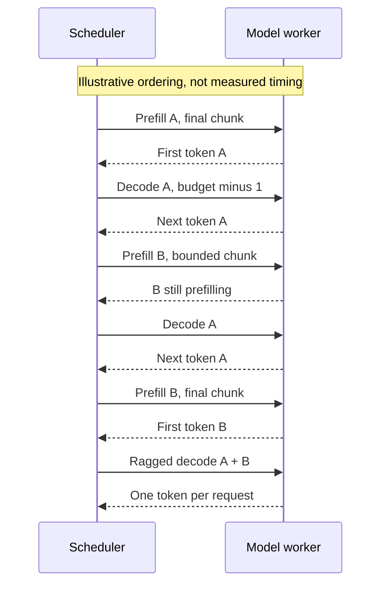
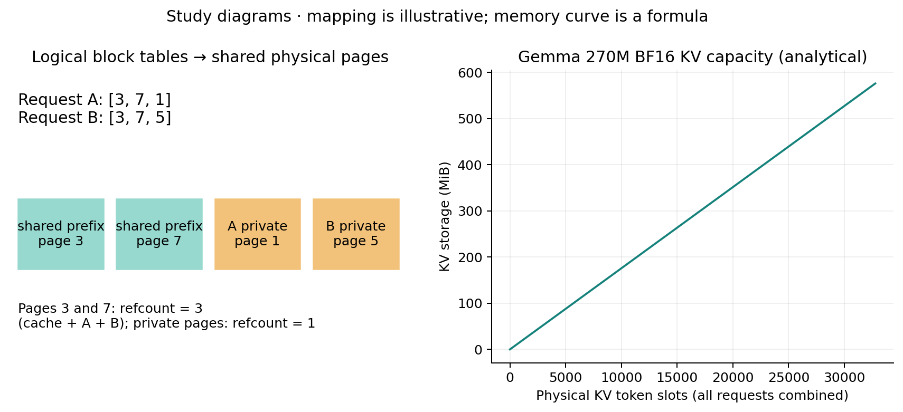

# Study guide

Read [architecture](architecture.md), then trace `routes.py` -> `app/service.py` ?
`inference/scheduler/scheduler.py` -> `executor.py` -> `gemma3/attention.py`.

## Token budgets and fairness

Decode generates one token per selected request. Prefill processes a chunk and
usually offers larger matrix operations. A token budget bounds scheduled work,
not GPU elapsed time: token cost still depends on context and model dimensions.



Explain why unconditional prefill priority starves decode, and why unconditional
decode priority can starve prefill. Locate both fairness tests. Explain why this
implementation uses separate forwards rather than a fused mixed batch.

## Page sharing and memory



```text
18 layers * 2 (K,V) * 1 KV head * 256 head dim * 2 bytes = 18,432 bytes / KV token
32,768 physical token slots = 576 MiB of KV tensors
```

This excludes weights, RoPE, activations and PyTorch's reserve. Page size 16 can
waste 15 tail positions per private reservation. Reserving future growth adds
unused capacity when requests stop early.

Trace references: cache (1), A attaches (2), B attaches (3), cache evicts (2), A
finishes (1), B finishes (0 -> free-list). Evicting an entry does not necessarily
free physical pages. Explain why exact prompt hits recompute a private final page.

## Attention and precision


Storage paging removes contiguous reservation requirements. A fused paged kernel
would additionally avoid dense KV reconstruction; this engine does not implement
one. Estimate bytes gathered per layer/token at 512, 2048 and 8192 context.
Sliding masking alone does not reduce gather length here.

Explain why `.item()` and Python tests on CUDA tensors synchronize the host.
The executor knows sequence bounds on CPU; sampled IDs still require one batch
transfer to drive serving. FP32 logits match the reference closely, while BF16
has a recorded greedy mismatch. Investigate accumulation order, kernel choice and
quantization before treating precision differences as harmless.

## Interpret the measurements


- TTFT includes queueing, prefill and scheduling before first text reaches the
  consumer. Sampled-token TTFT may be slightly lower.
- TPOT includes waits between decode turns, not just kernel execution.
- Throughput is actual output tokens divided by wall-clock time.
- Larger batches can increase aggregate throughput while worsening request latency.
- A p95 from 3-24 observations is descriptive and statistically weak.
- Worker handoff improves responsiveness but adds overhead; a microbenchmark gain
  need not improve single-request end-to-end latency.

## Next experiments

Profile dense gather and launches at longer contexts before choosing a maintained
paged attention backend. Compare chunk sizes under mixed short/long arrivals.
Measure prefix hit ratios and physical reclamation. Compare reservation with a
recompute/preemption policy before adding one. For vLLM, hold model, prompts,
sampling, dtype, token cap and arrival pattern constant. Do not extrapolate the
short-prompt sweep into workload-wide speedups.
