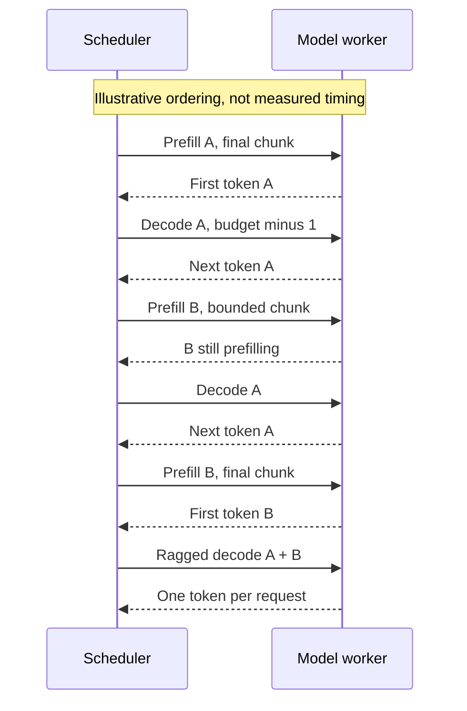
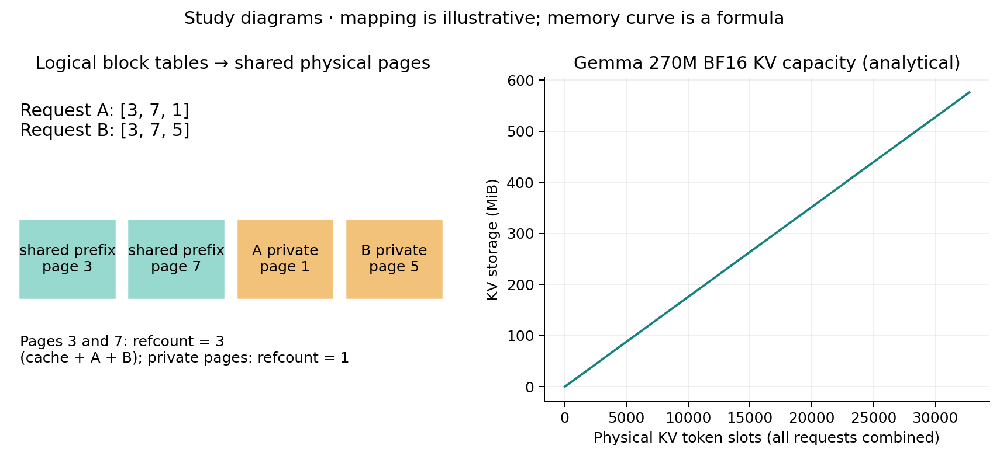
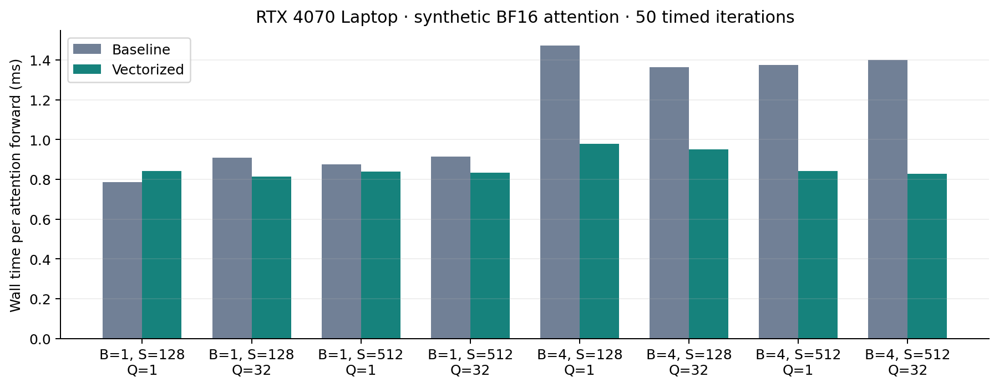
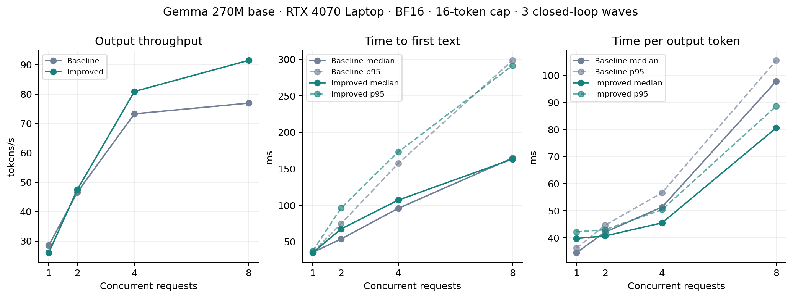

# Study guide

Read [architecture](architecture.md), then trace `adapters/openai/routes.py` -> `app/service.py` ->
`inference/scheduler/scheduler.py` -> `executor.py` -> `lfm3/model.py`, where
short-convolution and attention blocks alternate.

## Token budgets and fairness

Default S1 decode generates one token per selected request. Optional exact greedy
chunks queue several sequential steps for a settled cohort and charge every step
against the same budget. Prefill processes a chunk and
usually offers larger matrix operations. A token budget bounds scheduled work,
not GPU elapsed time: token cost still depends on context and model dimensions.



Explain why unconditional prefill priority starves decode, and why unconditional
decode priority can starve prefill. Locate both fairness tests. Explain why this
implementation uses separate forwards rather than a fused mixed batch.

## Trace an overlapped decode round

Follow `decode()` and `_copy_token_ids()` in `inference/executor.py`, then
`_run_decode()` and `_flush_stream_tokens()` in the scheduler. Identify when GPU
work is queued, when the event loop may emit an older prefix, and when the worker
can read sampled IDs or release pages. Explain why a frozen prefix length is
sufficient while the worker only appends to generated history.

Inspect `tests/test_execution_overlap.py` for cancellation and a slow consumer
while the worker is blocked. Explain why a stream callback records an error
instead of reclaiming KV immediately. Trace an EOS in the middle of an S8 chunk:
unused private positions may execute, but output/history stop at the first EOS.

Compare full-prefix decoding with `create_stream_decoder()` in the runtime and
`StreamingTextState` in the executor. Use `tests/test_incremental_text.py` to
explain an incomplete UTF-8 suffix and the one full decode at completion. Trace
metadata reuse through request-order/page-map checks and same-stream length
updates; explain why padded lengths must remain zero.

The [overlap report](../benchmarks/overlap_optimization/README.md) includes source
hashes, capture-free measurement checks and a trace measuring actual host/device
overlap. Explain why GPU activity of 100% does not prove peak arithmetic or memory
bandwidth, and why average token latency can hide bursty S8 streaming.

## Page sharing and memory



```text
11 attention layers * 2 (K,V) * 4 KV heads * 128 head dim * 2 bytes
    = 22,528 bytes / KV token
32,768 physical token slots = 704 MiB of KV tensors
```

This excludes weights, RoPE, conv state, activations and PyTorch's reserve. The
13 conv layers add `13 * 2,048 * 6 * 2 bytes ~= 312 KiB` of state per request.
Page size 16 can waste 15 tail positions per private reservation. Reserving
future growth adds unused capacity when requests stop early. Prefix caching is
disabled for LFM3 because a KV-only reuse would not restore conv state.

Trace references: cache (1), A attaches (2), B attaches (3), cache evicts (2), A
finishes (1), B finishes (0 -> free-list). Evicting an entry does not necessarily
free physical pages. Explain why exact prompt hits recompute a private final page.

## Attention and precision



Storage paging removes contiguous reservation requirements. The optional Triton
decode kernel in `lfm3/paged_attention.py` also avoids dense KV reconstruction and
reads only the live sliding window. The portable SDPA path gathers dense full
attention KV, while sliding attention bounds its gather to the visible window
and current chunk. Estimate bytes read by each path at 512, 2048 and 8192 context.

Explain why `.item()` and Python tests on CUDA tensors synchronize the host.
The executor knows sequence bounds on CPU; sampled IDs require one transfer per
batch or bounded greedy chunk. A long host wait in a copy can include preceding
GPU computation rather than PCIe transfer time. The tiny FP32 LFM3 model matches the reference to about
`1.27e-7`; real BF16 has one near-tie greedy mismatch on a raw prompt. Quantization
adds another controlled approximation: int8 preserved the tested greedy output,
while experimental int4 NF4 changed stop behavior. Investigate accumulation order,
kernel choice and quantization before treating precision differences as harmless.

## Interpret the measurements



- TTFT includes queueing, prefill and scheduling before first text reaches the
  consumer. Sampled-token TTFT may be slightly lower.
- TPOT includes waits between decode turns, not just kernel execution.
- Throughput is actual output tokens divided by wall-clock time.
- Larger batches can increase aggregate throughput while worsening request latency.
- A p95 from 3-24 observations is descriptive and statistically weak.
- Worker handoff improves responsiveness but adds overhead; a microbenchmark gain
  need not improve single-request end-to-end latency.

## Next experiments

Profile dense gather and launches at longer contexts before choosing a maintained
paged attention backend. Compare chunk sizes under mixed short/long arrivals.
For runtimes supporting prefix reuse, measure hit ratios and physical reclamation;
LFM3 needs matching convolution-state snapshots before enabling that path.
Compare reservation with a
recompute/preemption policy before adding one. For vLLM, hold model, prompts,
sampling, dtype, token cap and arrival pattern constant. Do not extrapolate the
short-prompt sweep into workload-wide speedups.
